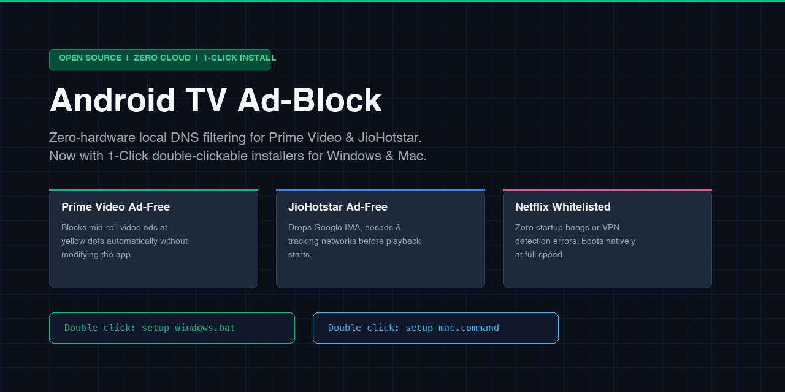
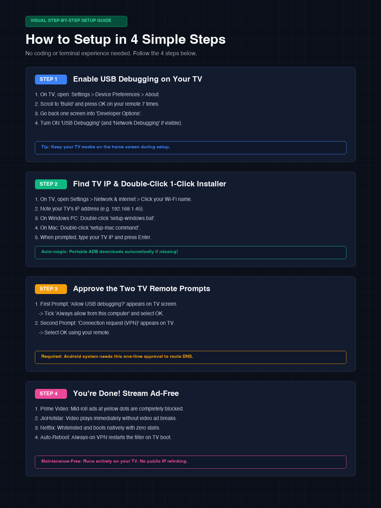

<p align="center">
  
</p>

# Android TV Ad-Block (Zero Hardware, 100% Free)

A free, open-source local DNS filter runs directly on the TV itself and answers DNS lookups. Ad servers get a dead-end answer (0.0.0.0), while real video content streams normally at full HD/4K quality. No account, no cloud subscription, no public IP to link, and no Raspberry Pi required.

This setup was proven on Hisense/Vu Android 11 TV (Prime Video, JioHotstar, Netflix, ZEE5, YouTube). Nothing here modifies any streaming app.

### 📁 Files in this repository:
- `setup-windows.bat`: **1-Click installer for Windows** (auto-downloads portable ADB, double-click to run).
- `setup-mac.command`: **1-Click installer for Mac** (auto-downloads portable ADB, double-click to run).
- `install-tvfilter.sh`: Linux and macOS Terminal installer (`./install-tvfilter.sh <TV_IP>`).
- `additionalHosts.txt`: Tailored ad rules loaded onto the TV.
- `assets/`: High-resolution visual setup infographics and architecture banners.
- `README.md`: Complete field guide, runbook, and troubleshooting.

---

## 0. What you get, and what you do not

You get:
- Prime Video: no ads at the mid-roll yellow dots (when Prime serves them from its `vod-dash-pv` servers).
- JioHotstar: no ads in our tests.
- YouTube, Netflix, and ZEE5 keep working.
- Starts by itself when the TV starts, and keeps working when the public IP changes.

You do not get:
- Prime's first ad when a movie starts. It comes from the same server as the movie, so no DNS filter can remove it.
- Ads that are stitched into live streams (live sports, live channels).
- A guarantee. Apps change their servers, so expect to re-check now and then (section 9).

Other apps on the TV may behave differently. Always test their main apps (section 8).

---

## ⚡ Choose Your Setup Path

<p align="center">
  
</p>

### 🖱️ Option 1: 1-Click Installer (Easiest for Everyone)

No terminal commands, no Homebrew, and no package manager required. The script automatically downloads portable ADB if missing:

1. **On your TV**:
   - Turn ON **Developer Options**: `Settings > Device Preferences > About > tap Build 7 times`.
   - Turn ON **USB Debugging**: `Settings > Developer Options > USB Debugging`.
   - Note your TV IP: `Settings > Network & Internet > select your Wi-Fi` (e.g. `192.168.1.45`).
2. **On your Computer**:
   - **Windows**: Double-click `setup-windows.bat`.
   - **Mac**: Double-click `setup-mac.command`.
   - Type your TV's IP address when prompted and press Enter.
3. **On your TV Screen**:
   - Prompt 1: Check "Always allow from this computer" and select **OK** for USB debugging.
   - Prompt 2: Select **OK** for the VPN Connection request.
4. **Done!** Open Prime Video or JioHotstar and enjoy ad-free playback.

---

### 🤖 Option 2: 1-Prompt AI Agent (Antigravity / Claude Code / Cursor)

If you have an AI coding assistant (such as **Antigravity**, **Claude Code**, or **Cursor**), simply copy and paste this single prompt:

```text
I want to block ads on my Android TV (Prime Video and JioHotstar) using this open-source project: https://github.com/atish23/android-tv-adblock

My TV is on the same Wi-Fi network at IP address: [INSERT_YOUR_TV_IP_HERE]

Please handle the complete automated setup for me:
1. Clone the repository if not already in the project directory.
2. Check if 'adb' (Android platform tools) is installed on this computer; if not, install it automatically.
3. Connect to my TV at [INSERT_YOUR_TV_IP_HERE]:5555 and notify me when I need to click "Always allow" on my TV screen.
4. Run the automated installer script (./install-tvfilter.sh [INSERT_YOUR_TV_IP_HERE]).
5. Prompt me when the TV displays the one-time "Connection request (VPN)" dialog so I can press OK on the remote.
6. Verify that the filter is running (process active, Private DNS off, Always-on VPN enabled).
7. Confirm when ready and streaming apps are ready to test.
```

---

### 💻 Option 3: Manual Terminal Script (Developers)

If you prefer using Terminal directly:
```bash
./install-tvfilter.sh <TV_IP>
```
Example: `./install-tvfilter.sh 192.168.1.45`

---

## 1. What you need (Manual / Developer Path)

- A laptop or Mac on the SAME Wi-Fi/LAN as the TV (or on a remote link, see section 11).
- An Android TV or Google TV (Android 8 or newer). Fire TV is different: see the note in section 2.
- About 20 minutes, and the TV remote.
- Internet on the laptop (to download adb and the app).

## 2. Prepare the TV (with the remote)

1. Settings, Device Preferences, About.
2. Press OK on **Build** seven times until it says "You are now a developer".
3. Go back, open **Developer options**.
4. Turn on **USB debugging**. If you also see **Network debugging** or **ADB over network**, turn that on too.
5. Keep the TV on during the whole setup.
6. Settings, Network and Internet: note the Wi-Fi network name. The TV must be on the same Wi-Fi as the laptop.

Fire TV: Settings, My Fire TV, Developer Options, turn on ADB Debugging and Apps from Unknown Sources.
We did not test Fire TV. The filter app uses a VPN permission, which Fire OS also supports, but verify it.

## 3. Install adb on the laptop

macOS (Homebrew):
```bash
brew install --cask android-platform-tools
```
Windows (PowerShell):
```powershell
winget install Google.PlatformTools
```
Linux (Debian/Ubuntu):
```bash
sudo apt install adb
```
Check it works:
```bash
adb version
```

## 4. Find the TV's IP address

Easiest: on the TV, Settings, Network and Internet, open your Wi-Fi network; the IP is shown
(for example `192.168.1.40`). Or look at the router's list of connected devices. On a Mac you can scan:
```bash
arp -a
```
Write the IP down as `<TV_IP>`. If the TV's IP changes later (DHCP), find it again by its MAC address.
To avoid this, set a DHCP reservation in the router for that TV if the router allows it.

## 5. Connect the laptop to the TV

```bash
adb connect <TV_IP>:5555
```
- First time, the TV shows **Allow USB debugging?** Choose **Always allow from this computer** and press OK.
- Run `adb connect` again after approving, then check:
```bash
adb devices
```
You must see `<TV_IP>:5555   device`. If it says `unauthorized`, approve the prompt on the TV. If it says
`offline`, wake the TV, or run `adb disconnect` and `adb connect <TV_IP>:5555` again.

From now on, use this so you do not repeat the address:
```bash
export ANDROID_SERIAL=<TV_IP>:5555
```
(Windows PowerShell: `$env:ANDROID_SERIAL="<TV_IP>:5555"`.)

Useful identity checks:
```bash
adb shell getprop ro.product.model
adb shell getprop ro.build.version.release
```

## 6. Install the filter (choose A or B)

### Option A: one script (recommended)

macOS or Linux:
```bash
git clone https://github.com/atish23/android-tv-adblock.git
```
```bash
cd android-tv-adblock
```
```bash
./install-tvfilter.sh <TV_IP>
```
(No git? On the GitHub page use the green "Code" button, "Download ZIP", and unzip it.)
It downloads the app from F-Droid, checks its SHA-256, installs it, asks you to press OK on the TV's
connection request, writes our settings and rules, turns Private DNS off, sets Always-on VPN, and prints a check.
Skip to section 8 when it says OK. Windows users: use section B, or run the script in WSL.

### Option B: the same thing by hand, line by line

**B1. Download the app and check it.**
```bash
curl -fL -o dnsfilter.apk https://f-droid.org/repo/dnsfilter.android_1506105.apk
shasum -a 256 dnsfilter.apk
```
The checksum must be exactly:
`73489010f4d28800cc7ea8fa10b2c8b340c3f19ce81ba56760b4dc4054869039`
(Linux: `sha256sum dnsfilter.apk`.) If it does not match, stop. App page: https://f-droid.org/packages/dnsfilter.android/

**B2. Install it.**
```bash
adb install dnsfilter.apk
```
Expected last line: `Success`. Optional check of what you installed:
```bash
adb shell pm list packages | grep dnsfilter
adb shell dumpsys package dnsfilter.android | grep versionName
```

**B3. Open it once so it creates its settings files.**
```bash
adb shell am start -n dnsfilter.android/.DNSProxyActivity
```
The TV shows a **Connection request** (Android asks to allow a local VPN). Press **OK**.
If you do not see it, press **Start** in the app. This is the one step that must be done on the TV screen.
The app is not listed in the TV home screen (it was made for phones), but it is installed and runs.

**B4. Stop it and edit its settings.**
```bash
adb shell am force-stop dnsfilter.android
adb pull /sdcard/Android/data/dnsfilter.android/files/PersonalDNSFilter/dnsfilter.conf dnsfilter.conf.orig
cp dnsfilter.conf.orig dnsfilter.conf
```
Edit with this command (macOS uses `sed -i ''`; on Linux use `sed -i` instead):
```bash
sed -i '' -E \
  -e 's/^detectDNS = .*/detectDNS = false/' \
  -e 's#^fallbackDNS = .*#fallbackDNS = [1.1.1.1]::443::DOH::https://cloudflare-dns.com/dns-query; [9.9.9.9]::443::DOH::https://dns.quad9.net/dns-query#' \
  -e '/^filterAutoUpdateURL_switchs/ s/true/false/g' \
  -e 's/^showInitialInfoPopUp = .*/showInitialInfoPopUp = false/' \
  -e 's/^androidAppWhiteList = .*/androidAppWhiteList = com.netflix.ninja/' \
  dnsfilter.conf
```
What each line does:
- `detectDNS = false`: do not copy the network's DNS servers.
- `fallbackDNS = ...`: upstream resolvers that do NOT filter (Cloudflare and Quad9 over encrypted DNS), so our own rules are the only filter.
- `filterAutoUpdateURL_switchs ... false`: turn off all the app's big default ad lists. They block Amazon servers that Prime Video needs (movies failed with "Something went wrong" until we removed them).
- `showInitialInfoPopUp = false`: no first-run popup on the TV.
- `androidAppWhiteList = com.netflix.ninja`: bypasses the local VPN for Netflix so Netflix avoids VPN detection and boots instantly without hanging.

**B5. Push settings and our rules to the TV.**
```bash
adb push dnsfilter.conf /sdcard/Android/data/dnsfilter.android/files/PersonalDNSFilter/dnsfilter.conf
adb push additionalHosts.txt /sdcard/Android/data/dnsfilter.android/files/PersonalDNSFilter/additionalHosts.txt
```

**B6. Turn Private DNS off, set Always-on VPN, start the app.**
These are system settings, so you run them yourself.
```bash
adb shell settings put global private_dns_mode off
adb shell settings put secure always_on_vpn_app dnsfilter.android
adb shell am start -n dnsfilter.android/.DNSProxyActivity
adb shell input keyevent KEYCODE_HOME
```
Why Private DNS must be off: with it on, all DNS on our TV stopped working after Android re-checked it
(YouTube showed "Can't connect right now"). The app warns about this itself.
Do not enable the stricter "block connections without VPN" (lockdown). Leave it off, so the internet keeps
working if the filter ever stops.

## 7. Check that it is really running

```bash
adb shell pidof dnsfilter.android
```
Prints a number when the app is running.
```bash
adb shell dumpsys connectivity | grep -oE "DnsAddresses: \[[^]]*\]" | sort -u
```
You should see `DnsAddresses: [ /10.10.10.10,...` (the app's own address). That means Android sends DNS to the filter.
```bash
adb shell settings get global private_dns_mode
adb shell settings get secure always_on_vpn_app
```
Expected: `off` and `dnsfilter.android`.
```bash
adb shell ping -c1 -W3 www.youtube.com
```
Must resolve (print an IP). If it says "unknown host", see troubleshooting (section 10).

## 8. Test the ads, app by app

Read what the filter is doing (live log file on the TV):
```bash
P=/sdcard/Android/data/dnsfilter.android/files/PersonalDNSFilter/log/trafficlog
adb shell "cat $P/*" | tr -d '\r' | grep -aE ", (0\.0\.0\.0|::)," | awk -F', ' '{print substr($1,12)" "$4}' | sort -u | tail -30
```
Every line is an ad host that was blocked. Lookups it allowed (queries):
```bash
adb shell "cat $P/*" | tr -d '\r' | grep -a "Q-1," | awk -F', ' '{print substr($1,12)" "$4}' | sort -u | tail -40
```
Restart an app before testing (it caches addresses):
```bash
adb shell am force-stop com.amazon.amazonvideo.livingroom   # Prime Video
adb shell monkey -p com.amazon.amazonvideo.livingroom -c android.intent.category.LEANBACK_LAUNCHER 1
```
Other package names: JioHotstar `in.startv.hotstar`, ZEE5 `com.graymatrix.did`, SonyLIV `com.sonyliv`,
YouTube `com.google.android.youtube.tv`. Find any with `adb shell pm list packages | grep -i <name>`.

Test plan:
1. YouTube: play a video. Must work.
2. Every streaming app you use: open it, play something, let it pass an ad break.
3. Prime: play past a yellow dot (a title you have not watched today; Amazon limits how often it shows ads).
   Success is a "blocked" line for `vod-dash-pv...` in the log and no ad on screen.
4. Reboot the TV once (hold power on the remote, or `adb reboot`). The filter should be back about a minute later:
```bash
adb shell pidof dnsfilter.android
```

## 9. Tuning rules for their apps (the playbook)

If an app breaks (spinner, "Something went wrong", stuck loading):
1. Right after it fails, list what was blocked (section 8 first command).
2. The newest blocked host is the suspect. Put `# ` in front of that line in `additionalHosts.txt`.
3. Push the file again and restart the filter:
```bash
adb push additionalHosts.txt /sdcard/Android/data/dnsfilter.android/files/PersonalDNSFilter/additionalHosts.txt
adb shell am force-stop dnsfilter.android
adb shell am start -n dnsfilter.android/.DNSProxyActivity
adb shell input keyevent KEYCODE_HOME
```
4. Retest the app. (This is exactly how we fixed ZEE5: it hangs forever if `imasdk.googleapis.com` is blocked.)

If an app still shows ads:
1. Play until the ad starts, then list the hosts asked for in that minute (section 8 second command).
2. Hosts only asked for around the ad, with names like ads, adserver, doubleclick, tremor, adsrvr, vast, are candidates.
3. Add one candidate to `additionalHosts.txt`, push, restart, retest.
4. If the host also carries the movie or show video, do NOT block it. Blocking it breaks playback (we saw this with Prime's `avoddashs3ww-a.akamaihd.net`).
5. Always re-test YouTube and the main apps after adding Google ad domains, because many apps share them.

## 10. Troubleshooting

| Symptom | Cause | Fix |
|---|---|---|
| `failed to connect ... No route to host` | Network debugging off, or wrong IP | Redo section 2, re-check the IP |
| `unauthorized` | TV prompt not approved | Approve it, tick Always allow, `adb connect` again |
| `device offline` | TV asleep or changed IP | Wake it, find the IP again, reconnect |
| `INSTALL_FAILED_...` | Old Android or storage | Check `adb shell getprop ro.build.version.sdk` (needs 17 or newer, practically Android 8+) |
| No VPN prompt on the TV | App not started | Press Start in the app, or run the `am start` command again |
| Websites do not load, "unknown host" | Filter running but its upstream failed, or Private DNS is on | Set `private_dns_mode off`, then `adb shell am force-stop dnsfilter.android` and start it again. As a last resort: uninstall the app, DNS returns to the network's |
| Movies fail with "Something went wrong" | A needed host is blocked (often a big list is on) | Section 9: un-block the newest blocked host; confirm all default lists are off |
| Netflix stuck on loading or logo | Netflix detects local VPN interface | Whitelist Netflix in filter config: add com.netflix.ninja to androidAppWhiteList |
| ZEE5 stuck on play | `imasdk.googleapis.com` blocked | Do not block it (already excluded in our file) |
| Ads come back after TV restart | Filter not yet started, or killed | Wait a minute after boot; confirm Always-on VPN is set; check `pidof` |
| Filter app missing from the TV menu | It is a phone app | Normal. Open with `adb shell am start -n dnsfilter.android/.DNSProxyActivity`, or Settings, Apps |
| TV IP changed, adb stopped working | DHCP | Find the new IP, `adb connect` again |

## 11. Notes and limits

- The app answers DNS only. Video traffic does not go through it, so speed is not affected.
- The first lookup of a brand new ad host is blocked immediately (it is local), so there is no slip-through like the cloud version had.
- Your TV vendor may kill background apps in standby. Always-on VPN restarts the filter; test a reboot.
- Remote setup (a TV in another home): ADB over the internet needs a private tunnel such as Tailscale. We did not test this; never expose port 5555 to the open internet.
- Newer version: the script pins the build we tested. If F-Droid later removes it, check the current build at
  https://f-droid.org/packages/dnsfilter.android/ , download it, compare its signing key and checksum with the F-Droid
  listing, install it the same way, then re-run section 6 B4 to B6 (the settings file format is the same, but check the
  four changed lines still match with `diff`).
- Terms of service: blocking ads may conflict with a streaming service's terms. This is for your own TV or one you have permission to configure.

## 12. Undo everything

```bash
adb shell settings delete secure always_on_vpn_app
adb shell am force-stop dnsfilter.android
adb shell pm uninstall dnsfilter.android
```
Private DNS stays off unless you turn it on again. When finished, switch **Developer options / USB debugging** off on the TV.
Your original app settings were saved as `dnsfilter.conf.orig` by the script (or by step B4).

## 13. Quick copy and paste cheat sheet

```bash
adb connect <TV_IP>:5555
export ANDROID_SERIAL=<TV_IP>:5555
adb install dnsfilter.apk
adb shell am start -n dnsfilter.android/.DNSProxyActivity
adb shell am force-stop dnsfilter.android
adb pull /sdcard/Android/data/dnsfilter.android/files/PersonalDNSFilter/dnsfilter.conf .
adb push dnsfilter.conf /sdcard/Android/data/dnsfilter.android/files/PersonalDNSFilter/dnsfilter.conf
adb push additionalHosts.txt /sdcard/Android/data/dnsfilter.android/files/PersonalDNSFilter/additionalHosts.txt
adb shell settings put global private_dns_mode off
adb shell settings put secure always_on_vpn_app dnsfilter.android
adb shell pidof dnsfilter.android
adb shell dumpsys connectivity | grep -oE "DnsAddresses: \[[^]]*\]" | sort -u
```

---

## Credits and licence

- The filter app is [personalDNSfilter](https://www.zenz-solutions.de/personaldnsfilter-wp/) by Ingo Zenz, open source, installed from [F-Droid](https://f-droid.org/packages/dnsfilter.android/). This repo does not ship the app; the script downloads the official F-Droid build and checks its SHA-256.
- The scripts, rules and guide in this repo: MIT licence (see `LICENSE`).
- Use it on TVs you own or have permission to change. Streaming services may change their servers at any time.
